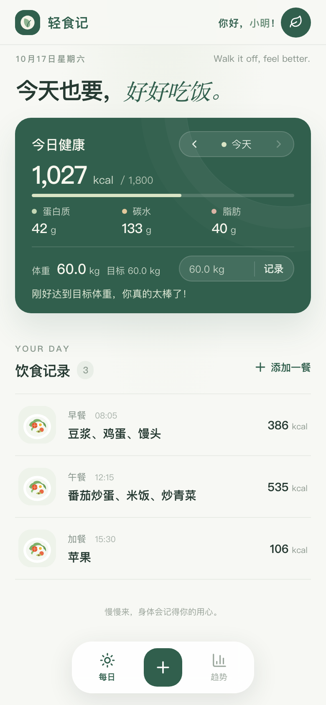
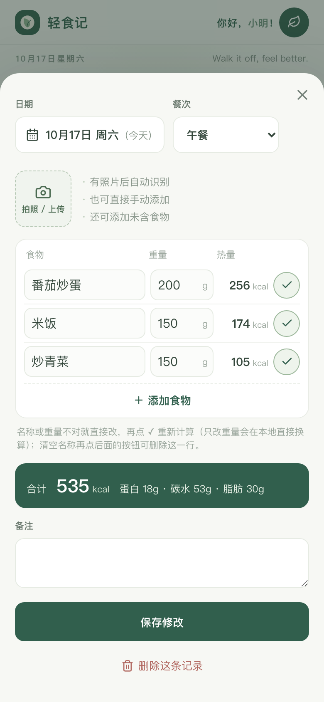
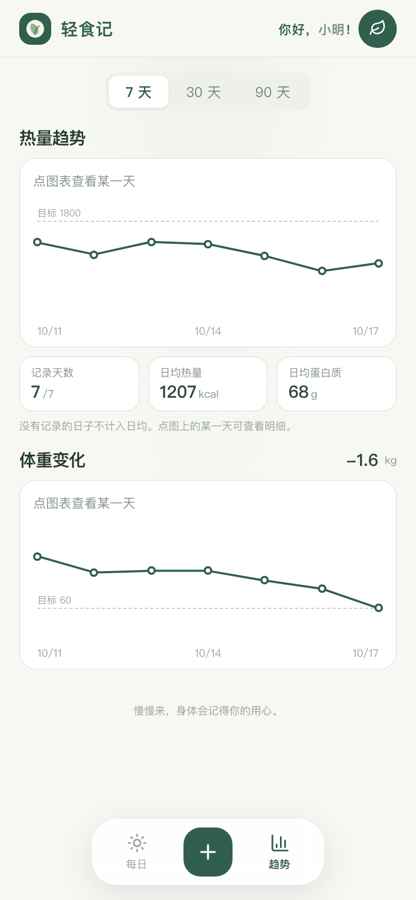
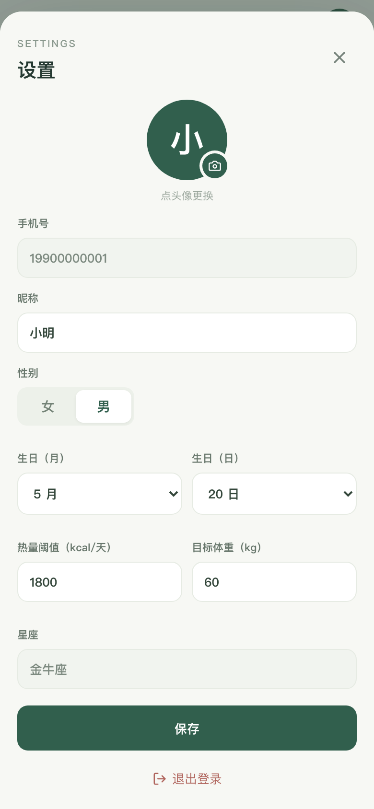

# 轻食记 · 私人饮食记录 PWA

给 3–10 位受邀用户用的饮食和体重记录工具：拍照识别食物、AI 估算热量和三大营养素、按天汇总和看趋势。主要在 iPhone Safari 上使用，可以添加到主屏幕当 App 用。

- 技术栈：Next.js 15（App Router，standalone 输出）+ Supabase（Postgres / Auth / Storage）+ OpenAI 兼容的视觉/语言模型（默认 DeepSeek）
- 部署：自建 Linux 服务器（nginx + systemd），可多台同时运行，前面可以套 Cloudflare 等 CDN

## 界面

| 首页 | 记录一餐 | 趋势 | 设置 |
| :---: | :---: | :---: | :---: |
|  |  |  |  |

截图用的是测试账号和演示数据。

## 功能

| 模块 | 说明 |
| --- | --- |
| 登录 | 手机号 + License，管理员在 `/admin/licenses` 签发，无短信、无邮箱 |
| 记录一餐 | 照片可选，可多张；上传后自动识别，识别出几种食物就列几行（食物、重量、热量、✓）。也可以不拍照直接手动添加，或添加照片里没有的食物。改名称或重量后点 ✓ 重新计算；清空名称再点即删除。可补录过去的日期 |
| 今日健康 | 当天摄入汇总（热量 / 蛋白质 / 碳水 / 脂肪，进度按个人热量阈值），前后翻日期；下方是体重栏，见下文 |
| 饮食记录 | 点记录编辑，点照片看大图；像 iOS 一样左滑露出"删除"（编辑页里也能删） |
| 体重 | 在今日健康卡片里直接记录，记在正在查看的那一天（每天一条），立即算出与目标体重的差额；输入不限小数位，存两位，显示保留一位 |
| 趋势 | 热量和体重折线图（都有目标线），7 / 30 / 90 天和本月，默认 30 天；点某一天查看或跳转；手机上一屏放下 |
| 设置 | 头像（可自行更换）、昵称、性别、生日（月日）、星座（由生日推算，带 emoji）、热量阈值（默认 2000 kcal/天）、目标体重、主题色（6 个预设） |
| 更新 | 发布新版本后，打开 App 或切回前台时自动检测并刷新；也可以在页面顶部下拉刷新，有新版本就更新，没有就只刷新数据 |
| 启动页 / 首页 | iOS 启动图 + 应用内启动页，显示每日一句积极、健康的短句；首页顶栏头像旁显示"你好，昵称！"，每日一句在日期同一行靠右 |
| 离线 | 页面、照片、食物数据本地缓存；保存先落本地，后台同步 |

营养数据都是估算值，份量、酱料和用油误差最大，保存前可以修改。

### 体重栏的提示

只用正在查看那一天的体重；那天没记就显示 `--`（输入框里灰色提示上一次的体重，从没记过则提示目标体重）。

| 与目标的差值 | 提示 |
| --- | --- |
| 高于目标超过 5 kg | 浅红字：预警，请注意合理控制体重 |
| 高于目标，5 kg 以内 | 距目标还差 x kg，请继续加油哦～ |
| 等于或低于目标 | 你真的太棒了！ |
| 低于目标超过 2.5 kg（男性 5 kg，未设性别按 2.5 kg） | 浅红字：预警，请注意合理控制体重 |

没设目标体重时提示去设置里填写。阈值在 `src/components/home.tsx` 的 `WeightPanel` 里。

## 架构

```
iPhone（PWA）
 ├─ Service Worker：页面缓存秒开、静态资源缓存
 ├─ 本地：照片缓存（7 天）、食物库缓存（7 天）、趋势数据（90 天）、待同步队列
 ├─ Supabase（直连，RLS 只能读写自己的数据）：饮食、体重、资料、照片、头像
 └─ 你的域名（CDN → nginx → Next.js）
      ├─ /api/auth/license   手机号 + License 登录，换取 Supabase 会话
      ├─ /api/admin/licenses 管理员签发 License
      ├─ /api/analyze        识图（视觉模型，1024px、关闭推理、同图缓存）
      ├─ /api/estimate       按名称 + 重量估算（先查食物库，再问语言模型）
      ├─ /api/quotes         未来 10 天的每日一句（只给旧版前端用，新版本地计算）
      ├─ /api/version        当前运行的构建版本（前端据此自动更新）
      └─ 后台任务            每 30 分钟按使用次数重估常用食物
```

服务端密钥（service role、模型 API key、管理员密钥）只在服务器上，浏览器拿不到。

## 目录

```
src/app/                 页面和 API 路由（api/analyze、estimate、quotes、auth、admin）
src/components/          home（主界面）、meal-modal（记录一餐）、trends、settings-modal、splash 等
src/lib/vision/          模型 provider：OpenAI 兼容接口、返回结果解析
src/lib/food-library.ts  服务端共享食物库读写
src/lib/food-names.ts    食物名称归一化（同义叫法 → 同一个库键），服务端和手机共用
src/lib/food-refresh.ts  食物库定时重估（由 src/instrumentation.ts 启动）
src/lib/food-cache.ts    手机本地食物库
src/lib/trend-store.ts   趋势页的本地数据（最近 90 天每天的汇总）
src/lib/theme.ts         主题色预设和切换
src/lib/outbox.ts        饮食记录的待同步队列
src/lib/photo-cache.ts   照片本地缓存
public/sw.js             Service Worker
supabase/schema.sql      数据库、存储桶、RLS、触发器（可重复执行）
scripts/import-cfct.mts  导入《中国食物成分表》到食物库
scripts/gen-icons.mjs    按 icon.svg 生成桌面图标 PNG
deploy/                  部署脚本、systemd 单元、nginx 配置
```

## 数据模型

| 表 / 桶 | 用途 | 访问 |
| --- | --- | --- |
| `user_licenses` | 手机号、License 哈希、对应的 Auth 用户、状态 | 仅服务端 |
| `user_profiles` | 昵称、性别、生日、头像路径、热量阈值 `calorie_goal`（800–5000，空为 2000）、目标体重 `target_weight`（25–300 kg） | 本人可读；只能改这些资料字段，不能改手机号和账号绑定 |
| `meal_records` | 一条饮食记录：日期、餐次、总营养、`dishes`（按照片分组的食物明细，每项含名称、库键 `key`、克数、热量、三大营养素；旧记录没有 `key`） | 本人 |
| `weight_records` | 每天一条体重 | 本人 |
| `food_library` | 共享食物库，每 100 克营养，含来源 `source`（`cfct` 成分表 / `ai` / `photo` / `manual`）、使用次数 `uses`、待更新标记 `needs_refresh` | 仅服务端 |
| `app_settings` | 键值配置，如 `food_refresh_every` | 仅服务端 / SQL |
| `meal-photos` 桶 | 饮食照片，按用户 ID 分目录 | 本人 |
| `avatars` 桶 | 头像，按用户 ID 分目录 | 本人 |

`schema.sql` 可以重复执行，用于新建和升级。

## 登录与 License

- 管理员在 `/admin/licenses` 输入手机号（11 位大陆号码或带国家码，统一存为 E.164）和管理员密钥，生成 License。明文只显示这一次，数据库只存 SHA-256 哈希。
- 用户必须同时输入手机号和对应的 License。服务端把手机号映射到一个内部 Supabase Auth 用户，签发会话后，浏览器用 RLS 直接读写自己的数据。
- 内部 Auth 密码只在创建账号和重新签发 License 时设置，登录时不改：Supabase 修改密码会注销该账号的所有会话，所以同一账号可以同时在多台设备（或 Safari 与主屏幕 App）登录。
- 重新签发会让旧 License 立即失效，并注销该账号已有的全部会话。撤销：把 `user_licenses.status` 改成 `revoked`。
- 浏览器端会话存在 localStorage（Safari 会把脚本写的 cookie 限制为 7 天）；旧版本存在 cookie 里的会话，首次打开新版本时自动迁移。
- Supabase 开着刷新令牌轮换：已作废的旧令牌再被使用时，会把该会话的令牌全部作废，用户被登出。为了容忍网络抖动导致的刷新回包丢失，把重用宽限 `security_refresh_token_reuse_interval` 设为 300 秒（Supabase 允许的上限，默认 10 秒），在控制台 Auth 设置或 Management API 里改。
- 最多 10 个手机号。Supabase 的公开注册已关闭；Email/Password provider 需保持开启，供服务端创建内部账号用。
- 每次调用 AI 接口都会校验登录状态和 License 是否有效，未授权时不会把数据发给模型。

## AI 识别与估算

模型调用封装在 `src/lib/vision/`，前端不绑定任何厂商。

| `VISION_PROVIDER` | 默认模型 | 说明 |
| --- | --- | --- |
| `deepseek`（默认） | `deepseek-flash` | 支持图片输入，价格最低 |
| `qwen` | `qwen-vl-max-latest` | 阿里百炼 OpenAI 兼容接口 |
| 其他名称 | — | 同时设置 `VISION_BASE_URL` 和 `VISION_MODEL`，任何 OpenAI 兼容接口都可以 |

- **识图** `/api/analyze`：浏览器把照片（含 HEIC）缩成最长边 1600px 的 JPEG 保存，另缩一份 1024px 的副本发去识别。模型逐项返回食物名称、估计克数、热量和三大营养素；关闭推理，超时 40 秒，通常 3–5 秒。同一张照片（按内容哈希）重复识别时直接用上次结果，不再调用模型。实测与 1600px + 推理相比，输入 token 少约 38%、输出 token 少约 84%，菜名识别不受影响，结果更稳定；768px 会认错菜，不要再往下压。
- **按名称估算** `/api/estimate`：只调用语言模型、不发图片，并关闭推理（DeepSeek 的 `thinking: disabled`），通常 1–3 秒。
- **只改重量**：直接在手机上按比例换算，不联网。
- **查找顺序**：手机本地食物库 → 服务端 `food_library` → 模型。模型或识图得到的新食物会自动入库，已有的不覆盖，所以同一种食物前后数值一致。
- **同义名**：查库前先用 `src/lib/food-names.ts` 归一化：西红柿/番茄、土豆/马铃薯/洋芋、鸡蛋/蛋等算同一种（"西红柿炒鸡蛋"和"番茄炒蛋"命中同一条）；括号里只是份量规格（450ml、约200克）时去掉，"少油""微糖"这类保留为不同食物。只收意思完全相同的叫法，发现漏掉的就往 `SYNONYMS` 里加一组。
- **中国食物成分表**：`food_library` 里 `source = 'cfct'` 的约 820 条来自《中国食物成分表标准版（第 6 版）》（数据取自 [Sanotsu/china-food-composition-data](https://github.com/Sanotsu/china-food-composition-data)，运行时下载，不放进仓库）。AI 不覆盖、不重估这些数值。表里多是生重，所以生肉、生鱼、生面条不对应到日常叫法（否则熟面条会算多近 3 倍），仍由模型估算；坚果按干重、蔬果按鲜重；别名有歧义的不收。导入或更新（可重复执行，先预演再写入）：

  ```bash
  node --env-file=.env.local scripts/import-cfct.mts          # 预演，打印将写入的内容
  node --env-file=.env.local scripts/import-cfct.mts --apply  # 写入；同时按新的名称规则合并库里已有的同义食物
  ```

- **定期重估**：每保存一条记录，触发器给其中每种食物的 `uses` 加 1（按食物项的 `key`，旧记录按名称）；每满 N 次标记待更新。服务端每 30 分钟认领一批（跳过成分表数据），让模型按"名称，100克"重估，新旧值各取一半。N 默认 30，修改后立即生效：

  ```sql
  update public.app_settings set value = '50' where key = 'food_refresh_every';
  ```

- **每日一句**：固定 60 条（`src/lib/quote-pool.ts`，中英文各半），分成两组按 30 天一段交替使用，每段内顺序随机打乱，所以任意 30 天内不重复。只由日期决定：同一天所有人看到同一句，离线也能算出来，不调用模型。首页把它放在日期同一行靠右，和日期之间至少留 5 个字，所以每句宽度控制在约 15 个汉字以内（英文字母按半个字算），新增句子时注意。英文统一小写（风格选择），专有名词照常大写，直接写在句子里，不用 CSS 转换。

没有选用百度菜品识别，因为它只给菜名和每 100 克热量，没有三大营养素，也不估份量。

## 主题色

设置里可选 6 个预设：青绿（默认）、海蓝、紫罗兰（DarkViolet #9400D3）、爱马仕橙、酒红、玫瑰金。不提供任意取色。爱马仕橙、玫瑰金的标准色偏亮，白字和卡片文字对比度不够，用的是满足 WCAG AA（4.5）时最鲜亮的版本（焦橙、灰调玫瑰）。

- 会变的：所有青绿色调的颜色，包括主按钮、健康卡片、选中态、带绿调的深色文字（如"今天也要"）和灰色文字（如日期）、页面底色、分割线、阴影、Logo。在 `globals.css` 里写成 `var(--c-xxxxxx,#xxxxxx)`（默认值就是原来的青绿）。不变的：红色（预警、删除、同步中）、橙色（未确认的热量、同步角标）、营养素三个圆点、白色叠加，以及默认示意图里的沙拉。
- 换主题时把每个颜色的色相拉到目标色相附近（保留原来与主色色相差的 1/4）；`sat` / `light` 调整饱和度和亮度，幅度按颜色的深浅和饱和度加权（饱和的中间调变化最大，很浅的底色、很深的文字和灰色几乎不变），所以深浅层次和默认一致。每个预设都核对过 WCAG 对比度，和默认青绿持平或更高。
- 选择存在 `user_profiles.theme`，换设备也跟着走；本机另存一份算好的颜色，`layout.tsx` 里的内联脚本在页面绘制前套用，打开时不会先闪一下青绿。
- 浏览器顶栏颜色跟着主题变。桌面图标和 iOS 启动图始终是青绿：iOS 只在"添加到主屏幕"时读取它们，网页改不了已添加的图标，而重新添加又要重新登录，所以不跟随主题。
- 新增主题色时，在 `src/lib/theme.ts` 的 `THEMES` 里加一项（目标色相、饱和度和亮度系数），并重新核对对比度：白字/主色、主色/底色、卡片文字/主色都要 ≥ 4.5，灰色文字不低于默认青绿。

## 离线与同步

- **启动**：iOS 启动图（`public/splash/`，覆盖常见 iPhone 尺寸）→ 应用内启动页（读取登录状态期间显示）。Service Worker 有缓存时直接用缓存打开页面，后台更新。
- **自动更新**：每次构建生成一个版本号（`next.config.ts` 里的 `NEXT_PUBLIC_BUILD_ID`），前端在启动、切回前台和每 10 分钟请求 `/api/version` 比对。不一致时删掉缓存的旧页面并刷新；记录或设置弹窗开着时先不刷新，等关闭后再更新。提示区用红字显示"发现新版本"；同一版本只自动刷新一次，仍是旧版时提示用户彻底关闭后重开。
- **下拉刷新**：页面在顶部时下拉松手。服务器有新版本就清掉缓存的旧页面并重新加载（用户主动操作，不受"只自动刷新一次"限制）；没有新版本或连不上服务器时只重新拉取数据，不清缓存，避免离线时打不开。弹窗打开或横向滑动时不触发。
- **提示**：成功类提示（资料已保存、已记录体重、已同步）3 秒后自动消失；失败类提示保留，手动关闭。
- **保存 / 删除**：照片先存进本地缓存，记录写入待同步队列（`localStorage`），弹窗立即关闭。后台依次上传照片、写数据库、删除被替换的旧照片。联网恢复、打开 App、或每分钟一次会自动重试。记录 ID 在客户端生成，写入都是 upsert，重试不会重复。提示区显示"正在同步 N 条记录"，完成后显示 3 秒"所有饮食记录已同步"。
- **照片**：按存储路径缓存在 Cache Storage 中，保存 7 天；离线时过期的照片也照样显示。
- **趋势页**：只读本地保存的最近 90 天每日汇总（热量、蛋白质、体重），打开即显示，不等网络。首页每加载一天就顺带更新那天的汇总，所以本机的新增、修改、删除会立刻反映。只有本地不完整时才请求服务端：先查一次用户最早有记录的日期，需要的起点 = max(所选范围的起点, 首次记录日)，本地已覆盖到这天就不请求，否则一次拉取 90 天。其他设备录入的数据在下拉刷新时同步。
- **当天数据**：Supabase 连不上时，显示上次缓存的当天数据，并每 10 秒重试一次；拉到最新数据后提示自动消失。

## 本地开发

1. 复制 `.env.example` 为 `.env.local`，填写：
   - `NEXT_PUBLIC_SUPABASE_URL`、`NEXT_PUBLIC_SUPABASE_ANON_KEY`
   - `SUPABASE_SERVICE_ROLE_KEY`（只在服务端用，不能加 `NEXT_PUBLIC_` 前缀）
   - `LICENSE_ADMIN_SECRET`（至少 32 位随机字符）
   - `VISION_PROVIDER`、`VISION_API_KEY`（可选 `VISION_BASE_URL`、`VISION_MODEL`）
2. 执行 `supabase/schema.sql`（SQL Editor，或 `npx supabase db query --linked --project-ref <ref> -f supabase/schema.sql`）。
3. 启动：

   ```bash
   npm install
   npm run dev          # 开发
   npm run build && npm start   # 本地跑生产版本（Service Worker 只在生产版本注册）
   ```

4. 测试用固定测试账号，手机号和 License 放在 `.env.test.local`（已被 git 忽略，也不会同步到服务器）。不要每次新建和删除测试用户。

## 部署

在本机构建 standalone 包，用 rsync 推到一台或多台服务器，由 systemd 运行、nginx 反代。应用本身无状态（数据都在 Supabase），多台服务器可以同时运行，配合 DNS 切换做主备。

1. 复制 `deploy/deploy.env.example` 为 `deploy/deploy.env`（不进 git），填写服务器、域名、端口和 nginx 监听方式。
2. 每台服务器初始化一次（可重复执行；`nginx -t` 失败会自动回滚）：

   ```bash
   deploy/setup-server.sh <host> <证书路径> <私钥路径>
   ```

   会创建 `lightmeal` 系统用户、`light-meal.service`（内存上限 320M）和 nginx 站点。如果 443 由 nginx stream 按 SNI 分流，设置 `NGINX_SNI_BACKEND` 后脚本会把域名加进 SNI map。

3. 发布：

   ```bash
   deploy/deploy.sh          # 发布到 DEPLOY_HOSTS：构建、同步 /etc/light-meal.env（来自 .env.local，不含数据库密码）、重启、健康检查，保留最近 3 个版本
   deploy/deploy.sh host2    # 只发某一台
   ```

服务器需要 Node.js 20+、nginx（1.25+，使用了 `http2 on`）、rsync，以及能用 root 登录的 SSH。

## 运维与排查

```bash
journalctl -u light-meal -f        # 应用日志（识图、估算、食物库重估都会打日志）
systemctl restart light-meal
curl -s --resolve <域名>:443:127.0.0.1 https://<域名>/   # 在服务器上绕过 CDN 测源站
```

注意事项：

- 如果前面套了 Cloudflare：源站不要返回 502/504，否则会被换成 Cloudflare 自己的非 JSON 错误页；接口出错统一用 503。
- 推理模型的推理 token 也计入 `max_tokens`，上限太小会返回空内容（识图和估算都已关闭推理）。
- 页面细节对齐以真机为准：Chromium 和 Playwright WebKit 模拟都显示居中的顶栏问候语，在 iPhone 上仍偏上，最后按真机效果下移了 1px（`.topbar-user .greeting`）。
- 本机如果通过 Clash 等工具走 TUN 代理，`curl --resolve <IP>` 仍会按域名被转发到 CDN；要测源站，请在服务器上执行。
- iOS 的启动图要删除主屏幕图标后重新"添加到主屏幕"才会更新。页面里的品牌图标是内联 SVG（`src/components/brand-icon.tsx`，和 `public/icon.svg` 同图形），换图标时要同步改这两处，并用 `scripts/gen-icons.mjs` 重新生成桌面图标、重新生成 `public/splash/` 下的启动图。
- 用户反映被自动登出：查 `auth.refresh_tokens`，某个令牌被作废却没有对应的新令牌，说明是旧令牌被重用触发了上面的轮换保护（`auth.audit_log_entries` 在新项目里是空的）。

## 已知限制

- 食物库还没有管理页面，修改数值需要直接改表。
- 照片从 Supabase Storage 直接加载，首次查看和上传受用户到 Supabase 区域的网络影响。
